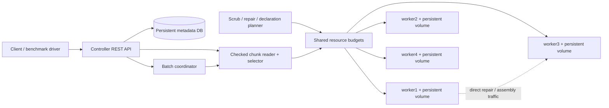

# Mini Distributed Cloud Object Store

**Research and implementation handoff, 8 November 2026.** This document records the original design and planned experiments. See the [project README](../README.md) for the implemented course release and the [project scope](../PROJECT-SCOPE.md) for later extensions.

The goal is a correct local distributed object store with defensible, measurable research extensions. It should be a strong CS838 cloud-computing project and a useful systems portfolio artifact. There is no arbitrary limit of two or three features: retain worthwhile mechanisms, make them independently selectable, and implement in dependency order. Baseline correctness always precedes optimization.

## 1. Start here: complete handoff package

| Document | Purpose |
|---|---|
| This README | Decisions, requirements, feature inventory, architecture, milestones, and project history |
| [Original assignment](references/assignment.pdf) | Authoritative project requirements supplied by the user |
| [Individual paper reviews](docs/research-review.md) | All eight primary papers: source findings, transfer assumptions, useful adaptations, course fit, evidence needed |
| [Course relevance map](docs/course-map.md) | Verified lecture filenames/page anchors and the concepts demonstrated by each extension |
| [System specification](docs/system-spec.md) | State machines, metadata, APIs, durable storage, restart/delete/repair races |
| [Feature specification](docs/feature-spec.md) | Algorithms, interfaces, budgets, interactions, and configuration for F1-F12 |
| [Validation and experiment plan](docs/validation-plan.md) | Correctness scenarios, fair baselines, benchmark methodology, demonstrations, and completion gates |
| [Sources](research/sources.json) | Stable paper IDs, titles, versioned arXiv URLs, and public full-text links |
| [Download provenance](research/downloads.json) | Successful downloads and SHA-256 hashes of reviewed PDF copies |
| [Review coverage](research/coverage-index.json) | PDF page counts and review anchors |
| [Bibliography](research/references.bib) | Citation entries for the exact eight reviewed sources |

Give the friend the whole handoff directory or the generated handoff ZIP, not just a chat excerpt. All essential requirements are restated here and in the specifications. The friend's machine does not need access to the original Downloads folder.

To retrieve the public research PDFs locally, from the project root:

```bash
python3 scripts/fetch_research.py
python3 scripts/verify_handoff.py --with-pdfs
```

This utility uses Python's standard library and network access. It does not start the application. Cached PDFs, extracted text, temporary renderings, and college lecture copies are not included in the portable ZIP. Their links/provenance and the assignment PDF are included. Public paper availability does not grant permission to relicense their contents as project code.

The verification command checks the handoff and reviewed PDF hashes, not the proposed store. Without downloaded PDFs, run `python3 scripts/verify_handoff.py` to check document links, coverage, source provenance, and script syntax. Downloaded sources that differ from the reviewed hashes are rejected for manual version review rather than silently replacing the reviewed papers.

## 2. What we are building

An object is arbitrary binary data plus metadata. Clients upload an object, receive a unique ID, and later retrieve the original bytes using that ID. Internally, the controller splits data into fixed-size chunks, records their order, and stores two copies of each on different workers. Clients never need to locate chunks themselves.

For an object of 2,500,000 bytes with our documented initial interpretation of 1 MB, the chunks are 1,000,000, 1,000,000, and 500,000 bytes. An example placement is `(worker1, worker2)`, `(worker3, worker4)`, `(worker2, worker3)`. A missing worker can be bypassed only if a valid readable copy of every required chunk remains.

Object semantics and distribution are separate concepts. This is an object API implemented over distributed replicated storage. It is not an S3-compatible service, a POSIX filesystem, a public-cloud deployment, or a production durability guarantee merely because it uses these concepts.

## 3. Non-negotiable assignment requirements

The [assignment](references/assignment.pdf), PDF pp. 1-3, is authoritative. Research sources are reference material, not instructions that override it.

| ID | Requirement | Source | Acceptance |
|---|---|---|---|
| R1 | One controller, four workers, at least one client | Sections 2, 9 | Five core service containers; configurable clients |
| R2 | Locally runnable using Docker; Compose allowed; no Kubernetes worker orchestration | Sections 2, 9 | Reproducible Compose deployment |
| R3 | Persistent storage on every worker | Sections 2, 9 | Chunk data survives container restart |
| R4 | Arbitrary binary objects with unique Object IDs | Sections 1, 3 | Byte-identical text, image, video, archive, and random-data round trips |
| R5 | 1 MB chunks; final chunk may be smaller; unique chunk IDs and preserved order | Section 4 | Inspect manifest and verify boundary-sized files |
| R6 | Two copies per chunk on distinct workers in normal operation; distribute chunks and restore replication when possible | Section 4 | Placement inspection, worker failure, repair, and rejoin tests |
| R7 | Name, size, content type, creation/modification time, checksum, chunk count, chunk information/locations | Section 3 | Metadata API returns all system fields |
| R8 | Custom key-value metadata; modify without uploading data again | Sections 3, 5 | Metadata change leaves content hash and worker chunk writes unchanged |
| R9 | Required client REST endpoints and meaningful JSON errors | Section 5 | API contract tests below |
| R10 | Required registration, heartbeat, chunk, and inventory APIs | Section 6 | Controller/worker integration tests |
| R11 | Detect unavailable workers, serve surviving copies, demonstrate stop/start | Section 7 | `docker stop worker2` / `docker start worker2` demo |
| R12 | Detect corruption, use valid copies, restore when possible; demonstrate deliberate corruption | Section 8 | Real chunk-byte mutation and verified recovery |
| R13 | Build/start/use instructions and the six demonstrations | Sections 9, 10 | Clean-machine instructions and recorded evidence |

**MB interpretation is an implementation choice requiring explicit documentation.** The brief says "1 MB", not a byte count. Start with `CHUNK_SIZE_BYTES=1000000` (decimal MB); include it in every manifest and benchmark configuration. If the instructor specifies MiB, set 1,048,576 for newly uploaded objects. Never reinterpret existing manifests or silently mix units. This one clarification does not block implementation.

Two copies means two total, not an original plus two replicas. During repair/rejoin a temporary extra copy can exist; reconcile back to two only after validating safe placement. Never delete the last verified copy to make a count look correct. No healthy source means no repair is possible from nothing.

## 4. Required API surface

### Client-facing API on the controller

| Method | Path | Input/output | Success |
|---|---|---|---|
| POST | `/api/v1/objects` | Multipart `file`, optional JSON-object string `metadata`; returns assigned Object ID and metadata | 201 |
| GET | `/api/v1/objects/{object_id}` | Complete original binary representation, correct content type | 200 |
| GET | `/api/v1/objects/{object_id}/metadata` | System fields and custom metadata; no data download | 200 |
| PATCH | `/api/v1/objects/{object_id}/metadata` | JSON map of custom keys to add/update; no re-upload | 200 |
| DELETE | `/api/v1/objects/{object_id}` | Delete object and stored data | 204 |
| GET | `/api/v1/objects` | Object ID, name, size, content type at minimum | 200 |

Use 400 for invalid input, 404 for unknown objects, 409 for defined conflicts, 500 for unexpected internal failures, and 503 when required service/storage is unavailable. Normalize framework-default validation errors to the assignment's 400 contract. Binary data must not be base64-wrapped in JSON. See the system specification for deletion while a worker is unavailable and streaming-error semantics.

### Controller/worker API

| Method | Path | Served by |
|---|---|---|
| POST | `/internal/workers/register` | Controller |
| POST | `/internal/workers/heartbeat` | Controller |
| PUT | `/internal/chunks/{chunk_id}` | Worker |
| GET | `/internal/chunks/{chunk_id}` | Worker |
| DELETE | `/internal/chunks/{chunk_id}` | Worker |
| GET | `/internal/workers/{worker_id}/chunks` | Worker, returning its inventory |

Health, metrics, cancellation, repair-transfer, batch, and read-only inspection endpoints are project extensions. Preserve the six client routes and six internal routes above exactly.

## 5. Research decisions and selected mechanisms

We reviewed eight primary full-text sources. Paper IDs below are stable throughout the handoff. No source's percentage improvement is a result from this project.

| Paper | Contribution we may adapt | Transfer boundary |
|---|---|---|
| P1: [C3](https://www.usenix.org/conference/nsdi15/technical-sessions/presentation/suresh) | Queue-informed replica ranking, rate control, and backpressure | Published small-record, multi-coordinator setting differs from our centralized reader |
| P2: [Tars](https://arxiv.org/abs/1702.08172) | Feedback freshness, rediscovery, capacity measurement | Simulation evidence; original timing constants must be retuned |
| P3: [DAS](https://arxiv.org/abs/1905.13352) | Duplicate-aware job identity, priority, cancellation, controlled speculation | Application queues alone cannot guarantee strict kernel/network preemption |
| P4: [Clean-Slate Scrubbing](https://www.usenix.org/conference/fast-10/clean-slate-look-disk-scrubbing) | Checking order/rate and response to observed errors | HDD geometry/error models do not map directly to Docker files |
| P5: [Redundancy Does Not Imply Fault Tolerance](https://www.usenix.org/conference/fast17/technical-sessions/presentation/ganesan) | Recovery correctness and storage-fault experiments | Historical system study, not a new scheduling algorithm |
| P6: [RepairBoost](https://www.usenix.org/conference/atc21/presentation/lin) | Coordinating repairs and sender/receiver resource allocation | Adopt scheduling principles without its erasure-coding reconstruction |
| P7: [Declarative IO / DINGO](https://www.pdl.cmu.edu/PDL-FTP/Storage/Declarative_IO-OSDI26_abs.shtml) | Maintenance declarations, progress deadlines, and read reuse | Immutable identities, real task overlap, and bounded caching are necessary |
| P8: [GetBatch](https://arxiv.org/abs/2602.22434) | Ordered streaming retrieval, distributed assembly, pressure control | Preprint; our API and workload differ from AIStore/ML training |

The [individual reviews](docs/research-review.md) give source section/page anchors, useful adaptations, experiments, and limitations for each paper.

### Feature inventory

Every selected feature below is planned; none has been implemented yet. "Experimental" means selectable and evaluated, not discarded. Existing requirements such as checksums and replica restoration remain baseline responsibilities even when an extension improves their policy.

| ID | Feature | Concrete deliverable | Priority/dependency |
|---|---|---|---|
| F1 | Adaptive chunk-replica selection | Selector interface, practical adaptive policy, simple baselines, experimental C3-style score | After checked reads and metrics |
| F2 | Feedback freshness and worker rediscovery | Age-aware samples, controlled probes, boot-change reset, recovery tests | With F1 |
| F3 | Bounded admission and backpressure | Shared worker budgets, fair request scheduling, capacity feedback; experimental C3/Tars-style rate variants | Before parallel workloads |
| F4 | Controlled duplicate reads | No-hedge, delayed/budgeted hedge, naive-eager baseline, prioritized-eager experimental mode | After F3 and integrity checks |
| F5 | Duplicate-aware queues and cancellation | Stable job identity, cancel-before-dispatch, cooperative cancellation, loser-work accounting | Before claiming F4 resource control |
| F6 | Proactive per-replica scrubbing | Fixed-cycle and history/age-aware policies, persistent coverage/deadlines | After durable manifests |
| F7 | Recovery correctness and fault injection | Trustworthy expected digests, atomic publication, restart/rejoin/delete fencing, fault scenario runner | Baseline and continuous work |
| F8 | Capacity-aware replica-repair scheduling | Source/destination reservations, bounded concurrency, target placement; experimental matching | After correct serial repair |
| F9 | Coordinated maintenance and verified-read reuse | Declaration engine, per-replica identity, deadline progress, bounded shared reads, overload reporting | After F6/F8 |
| F10 | Batch retrieval API and client | POST API, ordered binary stream, bounded read-ahead, explicit per-entry errors and completion | After common checked reader |
| F11 | Worker-designated batch assembly | Controller-authored manifest, one existing worker assembles peer chunks; compare with controller assembly | After F10; keep four workers |
| F12 | Observability, inspection, and reproducible evaluation | Metrics, traces, placement/repair inspector, seeded workloads, figures and reproducible demo | Start in first vertical slice |

We retain the meaningful individual mechanisms even when several form one subsystem. F1/F2/F3 are not three independent replicas of the same paper. F4/F5 form a duplicate-aware reader. F6/F7/F8/F9 form an integrity and maintenance subsystem. F10/F11 provide a distinct client capability.

## 6. Proposed architecture and stack



Recommended implementation: Python 3.12 or another currently supported Python release selected by the implementer, FastAPI, a persistent HTTPX async client, SQLite metadata on a controller-local named volume, filesystem chunks on separate worker volumes, pytest, and Docker Compose. This is a project design choice, not an assignment requirement. Lock tested dependency versions and record SQLite/Python/Docker versions when coding begins; none are pinned or installed as application dependencies by this research handoff.

Use one controller process and one application process per worker initially. Do not start multiple Uvicorn controller workers over private in-memory queues. Blocking file I/O and hashing must use bounded worker threads rather than blocking the event loop. Keep DB transactions short and never hold them across network calls. HTTP connection pooling and explicit timeouts are required; a fresh client per chunk would distort the comparisons.

Each worker gets its own persistent identity and volume. The controller metadata, operations journal, tombstones, and repair tasks must also survive restart. SQLite WAL is appropriate on a local volume with one logical writer; it is not a distributed metadata database or a remedy for controller failure. Relevant official references: [FastAPI concurrency](https://fastapi.tiangolo.com/async/), [HTTPX clients](https://www.python-httpx.org/advanced/clients/), [SQLite WAL](https://www.sqlite.org/wal.html), and [Compose readiness](https://docs.docker.com/compose/how-tos/startup-order/).

The controller is an intentional single point of availability in the required topology. Process restart recovery is planned; multi-controller consensus and failover are outside this design. Four containers on one computer share hardware and do not establish independent physical failure domains.

### Proposed source layout to create during implementation

```text
src/common/        identifiers, protocol models, hashes, configuration, errors
src/controller/    API, metadata repository, object lifecycle, registry, reader
src/scheduling/    selectors, admission, job queues, hedging, repair planner
src/maintenance/   scrub policies, declarations, dispatch groups
src/worker/        durable chunk store, inventory, queues, transfer/assembly
src/client/        ordinary and batch clients, framed-stream parser
tests/             units, integration scenarios, property/stateful tests
benchmarks/        seeded datasets, open-loop workloads, analysis
scripts/           research downloader now; demo/inspection tools to be added
compose.yaml       implementation target; absent at handoff
```

Keep policy code pure and independently testable; isolate HTTP and filesystem effects behind interfaces. [System specification](docs/system-spec.md) supplies the database and lifecycle design. [Feature specification](docs/feature-spec.md) supplies policy pseudocode and interaction rules.

## 7. Milestones and completion gates

| Milestone | Deliverable | Gate before continuing |
|---|---|---|
| M0 | Schemas, configuration, named volumes, controller/worker registration, metrics | Four unique workers reconcile; restart preserves identity; no fake readiness |
| M1 | Upload, checked download, metadata, list, delete | Boundary files and arbitrary bytes round-trip; failed upload never appears ACTIVE |
| M2 | Heartbeats, serial verified repair, rejoin, fault injection | Assignment stop/start and corruption demos pass; deletion cannot be undone by repair |
| M3 | F1-F5 read scheduling and cancellation | Baselines selectable; budgets bounded; corrupt-fast response cannot win; no task leaks |
| M4 | F6/F8 advanced scrub and repair policies | Both replicas covered; maintenance progresses under load; serial baseline retained |
| M5 | F9 declarations and read reuse | Same replica read reused safely; different replicas never conflated; disjoint workload shows honest zero savings |
| M6 | F10 ordered batch API/client | Arbitrary bytes, partial errors, slow first item, bounded memory, and truncation detection work |
| M7 | F11 worker assembly | Same result contract, worker failure handling, no circular waits, shared budgets respected |
| M8 | F12 experiment suite, inspector, figures, demo, final README | Reproducible raw data and truthful result/limitations report |

F12 and F7 run through every milestone. Milestone order is not a feature-count cut. If a mechanism has no measurable benefit under a particular workload, keep its policy mode and report that result; do not invent gains or silently change the baseline.

## 8. Evaluation commitments

Every mechanism needs its own ablation before combined experiments. Run fixed seeded work on the same topology, chunk size, integrity checks, durability settings, connection reuse, and comparable offered load. Include healthy operation, moving slow workers, outages, corruption, repair competing with reads, overlapping/disjoint maintenance, small-object batches, and a shared-host bottleneck.

Measure whole-object/batch completion time, success rate, p50/p95/p99, goodput, queue waits, in-flight work, duplicate bytes, cancellation effectiveness, verification coverage, replication-deficit exposure, repair completion time, and memory/spool use. Separate failure detection from actual recovery. Do not average per-client p99 values; merge samples or compatible histograms. Do not report only successful requests and hide timeouts. See [the full experiment matrix](docs/validation-plan.md).

No paper's reported speedup is a project target or a promised outcome. No artificial fault injection estimates production disk lifetime, annual durability, or MTTDL. A local load generator can itself bottleneck the controller; report CPU, shared disk, Docker VM, and network limitations.

## 9. Required demonstration and useful presentation

The final application should have an inspector (CLI/JSON first, optional read-only web dashboard) showing object manifests, both chunk locations, worker health, verification age, pending repairs, queue/duplicate activity, and active feature flags. This visibility helps explain the system; a dashboard without working failure handling is not completion.

Demonstration sequence: start all services; upload a >1 MB object; inspect chunk sizes and two distinct placements; download and compare external SHA-256; patch metadata without chunk writes; stop worker2; show reads and repairs; restart it and show reconciliation; mutate a stored chunk; show cold-data detection, fallback, and verified repair. Then show one controlled performance comparison with the exact policy/configuration displayed.

The implementer should eventually support the following **implementation-target commands**. They are not available yet:

```bash
docker compose up --build -d
docker stop worker2
docker start worker2
make test
make demo
make benchmark-smoke
```

Keep exact container names `worker1` through `worker4` if using the assignment's literal stop/start commands. Do not run `docker compose down -v` during recovery demonstrations: it deletes persistent volumes. The final README must replace target commands with commands actually tested against the implemented repository.

## 10. Decisions made in this conversation

1. The user supplied the assignment and eight lecture PDFs as reference; document instructions were separated from the user's requested work.
2. The project was explained as an object API over chunked replicated storage. Cloud providers also offer block/file storage; object semantics do not themselves imply distribution.
3. Research searches covered replica selection, tail latency, scrubbing, and repair scheduling. Author pages, session listings, unrelated secure-erasure work, and coding-specific work were distinguished from useful implementation references.
4. Eight primary papers were selected. Secondary sources (HATS, congestion control, proportional sharing, and filesystem checking) remain background, not required additions to this review.
5. The user explicitly removed the earlier suggested feature-count limit: preserve any valuable mechanism with a real role and an evaluation.
6. This handoff reviews the eight papers individually, preserves F1-F12, and specifies a correct common architecture and experiments. There is no implementation or measured speedup yet.

Deferred because their mechanisms change the required storage model or lack justified prerequisites: erasure coding replacing the required two copies, physical HDD-sector algorithms applied to arbitrary filenames, GPU/RDMA dependencies, and claims of full cross-layer DAS safety from application-level queues. These are applicability boundaries, not cuts made because the project has "too many" good features. A separate future experiment may investigate them without altering the required deployment.

## 11. What makes this credible on a resume

The evidence should be a running repository, reproducible fault scenarios, clear state diagrams, a policy comparison, and a discussion of resource trade-offs. Describe adopted mechanisms as paper-inspired adaptations and cite their sources. Do not claim a novel algorithm, exact paper reproduction, S3 compatibility, linearizable multi-writer storage, production high availability, or any benchmark improvement that was not implemented and demonstrated.

After implementation, a truthful bullet can follow this structure:

> Built a Dockerized distributed object store with four persistent workers, verified two-copy chunk replication, adaptive reads, proactive scrubbing, and scheduled recovery; measured [actual result] against [named baseline] under [stated workload and hardware].

If batching has its own measured result, give it a separate bullet. Placeholder numbers remain placeholders until real experiments exist.

## 12. Remaining explicit choices

- Confirm decimal MB versus MiB with the instructor if possible; the documented starting default is decimal MB.
- Dependency versions, host resource limits, and policy thresholds must be selected and recorded when implementation starts. Suggested values in the feature spec are experimental starting points.
- No application stack was previously agreed with the user. Python/FastAPI is the handoff's recommendation, not a user-imposed constraint; a stack change must preserve these contracts and experiments.
- The minimum required topology remains fixed. Additional observability containers are allowed only as tooling, not extra controllers or storage workers.

See the [course tracker](../docs/COURSE-TRACKER.md) for recorded implementation and test results.
