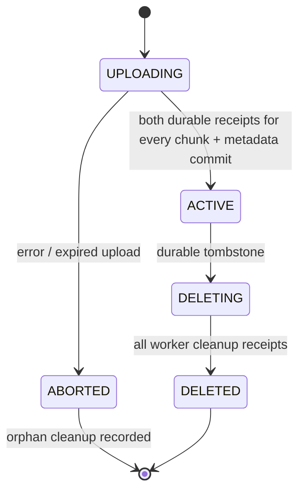
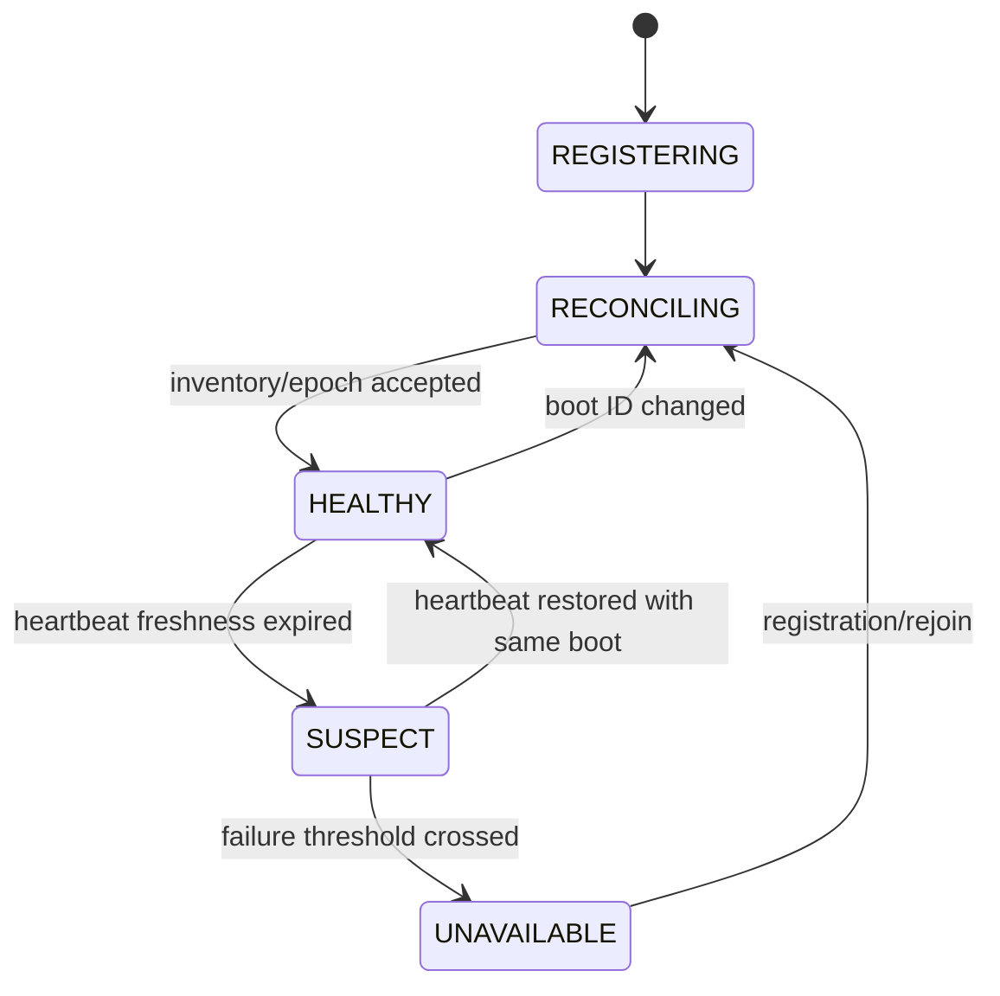

# System and correctness specification

This is the proposed implementation contract. It is our project design, not a claim that any paper implemented this exact system. The [assignment](../references/assignment.pdf) controls required behavior; the [README](../README.md) distinguishes requirements from extensions.

## 1. Scope, trust, and consistency

- One authoritative controller, four persistent workers. Clients address object IDs, not chunk locations.
- Object data is immutable after upload. A later upload, even with the same filename, creates a new Object ID. Only custom metadata can be patched.
- Object ID and chunk IDs are server-generated UUIDs. Object generation is an immutable UUID. Do not use filenames as storage paths or deduplication keys.
- Controller metadata is the authority for expected object/chunk SHA-256 values, lengths, order, lifecycle, and placement intents. Worker inventory is evidence, not authority to rewrite expected digests.
- This design assumes non-malicious services and trusted controller metadata. Checksums detect corruption; they do not authenticate a malicious controller, recover a lost manifest, or provide Byzantine consensus.
- A metadata transaction that changes UPLOADING to ACTIVE is the upload visibility point. No ordinary read/list/metadata operation exposes an incomplete upload.
- Metadata PATCH is a controller-local transaction. Data is immutable, so arbitrary replica selection does not create a mutable-data read-quorum problem. Do not advertise a general multi-writer linearizable key-value store.
- DELETE first records a terminal tombstone. Requests admitted before it may finish against their pinned manifest; new reads are rejected. Physical cleanup is tracked separately and must finish before a normal successful 204.
- Controller restart interrupts in-flight requests. Restart reconciles persisted state; it does not provide uninterrupted controller availability.

## 2. Durable metadata model

Recommended: SQLite on the controller's own named volume, foreign keys enabled, WAL mode, a busy timeout, and durable synchronous commits. Use an explicit repository layer and migrations. SQLite permits one writer at a time; serialize short writes and do not put network waits inside transactions. Detect database errors and fail closed rather than reconstructing an arbitrary manifest from whichever worker answers first.

Suggested tables (types may be represented by application models):

| Table | Required columns and constraints |
|---|---|
| `controller_state` | Singleton durable epoch, next operation sequence, schema version |
| `objects` | `object_id` PK, immutable `generation`, name, size_bytes, content_type, created_at, modified_at, object_sha256, chunk_size_bytes, chunk_count, state, metadata_revision, custom_metadata_json |
| `chunks` | `chunk_id` PK, object FK, generation, ordinal, length_bytes, expected_sha256; unique `(object_id, generation, ordinal)` |
| `workers` | `worker_id` PK, configured address, persistent storage identity, current boot_id, health state, last heartbeat receipt, capacity, reserved bytes |
| `replicas` | Composite PK `(chunk_id, worker_id)`, state, placement revision, committed intent sequence, length/digest receipt, last_verified_at, verification_epoch, worker boot observation |
| `operations` | Operation UUID, object/chunk, kind, durable sequence, controller epoch, status, intended workers, error, attempts, timestamps |
| `repair_jobs` | Unique active repair intent per chunk generation, source/destination, priority, reserved bytes, lease owner/expiry, status, attempts, next retry |
| `declarations` | Kind, generation/replica identities, remaining work, deadline, completion/error state, original coverage interval |
| `tombstones` | Object/generation, deletion sequence, creation time, per-worker cleanup receipts; retained permanently initially |
| `events` | Bounded structured audit events and experiment/run IDs; rotate rather than grow forever |

Do not store transient monotonic-clock values across reboots. Persist wall-clock UTC times for history/deadlines and rebuild monotonic scheduling deadlines at startup. Use worker-local duration measurements for queue/service time; absolute clocks on different machines need not agree.

Derived invariants:

1. `chunk_count = ceil(size_bytes / chunk_size_bytes)`; zero-length object has zero chunks and SHA-256 of empty bytes.
2. Ordinals are contiguous from zero; all full chunks have the manifest's chunk size, and only the final chunk can be smaller.
3. Two normal placements must have different persistent worker/storage identities. A worker's reboot does not create a new independent copy.
4. A VALID placement means it passed validation at its recorded time, not that future bytes can never change. Validate every actual read used to return/repair data.
5. Worker liveness and replica state are separate. An offline worker's last verified file may exist, but is not an available copy for routing or recovery.
6. Neither a repaired placement nor a late upload acknowledgement can make a DELETING/DELETED generation ACTIVE again.
7. Custom metadata can contain any bounded JSON value under string keys; it is namespaced separately from system metadata. It cannot change digests, lengths, IDs, or worker locations.

## 3. Object and worker state machines



ACTIVE objects can be degraded or unavailable without changing to an incomplete-upload state. Expose availability diagnostics separately. A read error is not permission to discard committed metadata.



Use controller heartbeat receipt time. Defaults to explore: heartbeat every 1 s, suspect after 3 s, unavailable after 5 s. These are experiment parameters, not proof of failure. Heartbeats do not distinguish a crash from a partition. A slow data response should affect performance routing, not immediately declare the worker dead. A heartbeat that still runs while disk operations fail does not prove storage health.

## 4. Worker storage and publication

Each worker has a separate named volume containing a persistent worker ID, a small catalog/tombstone database, chunk files, staging files, and quarantined files. `boot_id` is new on each process start. Validate paths using server-generated IDs, never an uploaded filename.

Durable PUT sequence:

1. Validate controller epoch, operation UUID/sequence, immutable IDs, expected length/digest, and configured maximum chunk length. Reserve capacity before accepting bytes.
2. Check that no terminal object tombstone or later placement operation forbids this write.
3. Write into a unique staging file. Bound memory and thread/executor concurrency. Reject truncated, excess-length, or checksum-invalid content; never publish it.
4. Flush and fsync staging. Under a short per-chunk commit lock, recheck sequence/tombstone conditions, atomically rename to the canonical location, and fsync the parent directory where supported.
5. Commit the local catalog receipt durably and return it. If catalog and filesystem publication cannot be one transaction, startup reconciliation must cover a crash between either step.

For a repeated PUT with the same immutable identity, operation, digest, and size, return the same result after validating the existing file. A different digest/length is a 409, not an implicit overwrite. A repair of a known corrupt file requires a newer authorized placement intent and atomic replacement; it cannot modify the expected content identity.

Every worker read checks expected length and SHA-256 before its bytes become eligible as a completed chunk. Read time includes hashing in every benchmark variant. Quarantine a corrupt file or mark it unusable and preserve diagnostic information. Never update the expected digest to the observed corrupt digest.

Fault-injection operations must use this storage abstraction and be explicitly enabled for the local demo profile. Provide a direct byte-mutation demo as well as simulated read/write errors. Never target files outside the selected worker's volume.

## 5. Upload protocol

1. Parse multipart headers and custom metadata. Stream data using bounded buffers; do not call an unbounded `read()` on the whole upload.
2. Create a durable UPLOADING object and upload operation. Incrementally calculate the object digest, chunk digests, sizes, and manifest ordinals. User-supplied filename is display metadata only.
3. For each chunk, choose two distinct HEALTHY workers with reserved free capacity and reasonable current utilization. A byte-balanced placement policy is an implementation design choice, not C3's read-selection algorithm.
4. Send PUTs and collect receipts for both copies. Use bounded chunk pipelining. Record successful receipts even if another request fails so cleanup/restart knows where staged data may be.
5. A timed-out PUT may have completed remotely. Retry the same operation idempotently or inspect the receipt; never assume timeout proves absence.
6. Commit ACTIVE only after every chunk has both durable validated receipts. Commit the final whole-object digest and manifest in the visibility transaction. Then return 201.
7. If sufficient storage is unavailable, return 503 and leave no ACTIVE partial object. Mark ABORTED, schedule cleanup, and retain its operation history until orphans are removed.

No degraded one-copy upload acknowledgement by default. Existing reads may survive on one copy; acknowledging new uploads with only one copy changes the assignment's normal-operation guarantee.

Handle 0, 1, C-1, C, C+1, 2C, and 2C+1 bytes, where C is the configured chunk size. Two uploads of equal bytes still get distinct object IDs; cross-object deduplication is not part of this design.

## 6. Ordinary checked download

Public GET takes an ACTIVE manifest snapshot and acquires a local read lease. Reject unknown/deleted IDs with 404. Worker placement selection and health may change during the read, but the object generation, lengths, order, and digests never change.

The `CheckedChunkReader` is the only path used by ordinary downloads, batch retrieval, and source reads that return user data. Its scheduling wrapper applies F1-F5; its integrity result is independent of policy choice. It returns bytes only after full-chunk validation. An invalid response can trigger a bounded alternate attempt and a repair notification.

**Default external error contract:** spool a completely verified object to a quota-controlled temporary file before sending HTTP 200. Verify the whole-object checksum, then send the file with exact Content-Length, stored content type (or application/octet-stream), safe Content-Disposition, and a digest/ETag header. The assignment can therefore receive JSON 503 before headers if a required chunk is unavailable. An empty file returns 200 with length zero.

Spooling adds disk work; keep it identical across baseline and optimized policies and measure controller spool overhead. Bound RAM, disk reservations, concurrent downloads, and temporary-file lifetime. If a requested object exceeds available spool quota, reject with a meaningful 503 rather than exhausting the host.

An additional verified-chunk streaming mode is worthwhile but has a different late-error contract: after 200 begins, a later failure must abort the stream, not append JSON or silently end successfully. Content-Length and client final-digest validation detect truncation. Do not claim a late failure can change an already sent HTTP status. Treat this as a separately named mode with explicit tests, not the default assignment behavior.

Concurrent chunk retrieval uses bounded lookahead and reconstructs by ordinal, using a reorder buffer or positioned spool writes. A slow chunk must not cause unbounded buffered later chunks. Cancel all outstanding work if the public client disconnects. Releasing one consumer must not cancel a shared worker read still needed by another consumer.

## 7. Metadata, list, and delete contracts

GET metadata returns at least:

```json
{
  "object_id": "server-generated-uuid",
  "name": "example.bin",
  "size_bytes": 2500000,
  "content_type": "application/octet-stream",
  "created_at": "UTC-RFC3339",
  "modified_at": "UTC-RFC3339",
  "checksum": {"algorithm": "sha256", "value": "hex"},
  "chunk_size_bytes": 1000000,
  "chunk_count": 3,
  "metadata_revision": 1,
  "custom_metadata": {"course": "CS838"},
  "chunks": [
    {"chunk_id": "uuid", "ordinal": 0, "size_bytes": 1000000,
     "sha256": "hex", "locations": ["worker1", "worker2"]}
  ]
}
```

This example abbreviates the chunk array; real output must contain all chunks (or an explicitly documented paginated representation). Worker locations are diagnostic metadata, never a requirement imposed on the client to retrieve data.

PATCH body is a JSON object of custom keys to add/update, e.g. `{"course":"CS838","experiment":2}`. Merge it atomically into `custom_metadata`, advance metadata_revision and modified_at, and preserve object/chunk digests, generation, and creation time. Null is a stored JSON null, not deletion. A custom key named `checksum` remains inside custom_metadata and cannot overwrite the system checksum. A metadata-size/key-count limit is a documented resource control; initial suggestions are 16 KiB encoded JSON and 100 keys, not assignment rules.

List returns only ACTIVE objects, sorted by creation time and Object ID. Cursor pagination is useful; declare its concurrent-change semantics. Do not promise a stable snapshot spanning pages unless implemented.

DELETE protocol:

1. Persist DELETING and a terminal object/generation tombstone, and allocate a new durable operation sequence. New GET/list/metadata access hides it immediately.
2. Cancel queued repairs/declarations and prevent new read leases. In-flight readers admitted before deletion may complete, but cleanup must coordinate worker read handles and commit locks.
3. Install durable object tombstones on **all four configured workers**, not just the two listed locations. This fences in-flight or orphan PUTs. Remove staged, canonical, and quarantined copies associated with that object after safe cancellation/handle coordination.
4. Collect all four durable cleanup acknowledgements, including a worker that says the object was absent. Commit DELETED and return 204.
5. If a worker is unreachable, keep deletion pending and return JSON 503 with `code=deletion_pending`. Do not claim physical cleanup with 204 while unreachable replicas may remain. A retry on a pending tombstone resumes deletion. New requests to a fully deleted ID return 404, matching the brief. An optional Idempotency-Key can replay a previous successful DELETE response if explicitly implemented.

Single-chunk excess-replica cleanup is different from object deletion: retire only that placement, not every chunk of the object on the worker. Retiring a placement records its operation sequence so an older PUT cannot re-create it; a later authorized placement intent can place that chunk there again. A terminal object tombstone never permits this resurrection.

The 503-on-pending-deletion choice is a conservative project policy because the assignment does not define unreachable-replica cleanup semantics. Document it in the final API, including the fact that logical hiding occurs before complete physical cleanup. It is not secure erasure of physical media.

## 8. Epochs, stale jobs, and restart recovery

The controller increments a durable controller epoch at startup. Every mutation command has an operation UUID, monotonically allocated durable sequence, controller epoch, object generation, and relevant placement intent. Workers retain the latest accepted epoch/sequence information. A delayed command with an older sequence than a tombstone/retirement is rejected.

The publication lock rechecks authority immediately before rename; checking only when the request first arrives is insufficient. The controller also uses conditional metadata updates so a stale completion cannot commit into a changed lifecycle or placement intent. Stale files that were safely written but never committed become reconciliation candidates, not visible objects.

Do not treat network sequence checks as a new consensus protocol. Authority is the single controller plus its durable metadata; unreachable workers may learn a new epoch later. Visibility still requires a current controller commit, and DELETE does not return 204 until every worker has installed the tombstone. This prevents claiming stronger distributed fencing than implemented.

On controller restart:

1. Open/migrate/check the metadata DB; fail closed on metadata integrity failure.
2. Increment epoch; terminate/rebuild process-local leases, samples, and scheduling state.
3. Recover UPLOADING/ABORTED and DELETING operations; inspect ambiguous PUT receipts before cleanup.
4. Expire old RUNNING job leases and enqueue bounded reconciliation. Do not acknowledge old in-memory success.
5. Register and inventory workers, reapply tombstones/retirements, compare committed manifests, and recreate missing repair/declaration work idempotently.

On worker restart, use the persistent worker ID and a fresh boot ID; scan staged/canonical/catalog state, re-register, install current epoch and tombstones, report inventory, and enter HEALTHY only after reconciliation. Reset performance measurements. Old files cannot overwrite trusted expected manifests. Keep quarantined files out of ordinary inventory success counts.

## 9. Serial repair and rejoin foundation

Implement this correctly before F8 parallel scheduling.

1. Select an ACTIVE chunk generation with fewer than two available validated placements. Coalesce duplicate repair triggers into one active intent.
2. If no available source remains, keep the job blocked with bounded backoff and expose unavailability. Do not declare permanent data loss solely because a worker is offline.
3. Choose a healthy destination not holding that placement, reserve bytes and resources, and record a durable intent.
4. Obtain expected digest/length from controller metadata. Transfer directly source-to-destination when possible; the controller coordinates rather than relaying every repair byte.
5. Validate source data, validate destination data, publish durably, then conditionally commit the new placement against the current generation, lifecycle, and repair intent.
6. Release reservations in every success, failure, cancellation, and timeout path. A timed-out transfer may have completed: reconcile its operation receipt instead of blindly creating another copy.
7. When an offline worker returns with an extra copy, verify it before classifying it. Choose two valid canonical placements, retire excess copies with newer placement sequences, and keep deletion receipts. Reconcile both inventory and committed metadata.

A full-worker outage creates many repair jobs. F8 changes their ordering/parallelism, not their integrity or commit protocol. If fewer than two distinct writable healthy workers exist, exact replication cannot be restored; continue valid reads where possible and report the deficit.

## 10. Internal protocol additions

Keep assignment routes. Extend their schemas and add the following implementation-target operations as needed:

| Operation | Proposed route | Rules |
|---|---|---|
| Cancel queued/in-flight attempt | `POST /internal/jobs/{job_id}/cancel` | Idempotent; cancellation result distinguishes queued removal from already-running work |
| Inspect operation receipt | `GET /internal/operations/{operation_id}` | Resolves ambiguous timeouts without trusting a guessed digest |
| Transfer a replica | `POST /internal/repairs` | Controller-issued immutable intent; destination/source IDs resolve through configured registry, not arbitrary URLs |
| Install terminal tombstone/cleanup | `POST /internal/objects/{object_id}/tombstone` | Durable, monotonic, generation-aware; acknowledges completion separately from acceptance |
| Check local chunk | `POST /internal/chunks/{chunk_id}/verify` | Fresh replica inspection unless joined to an eligible contemporaneous in-flight read |
| Batch assembly | `POST /internal/batches` | Worker consumes controller-authorized immutable manifest, shared budgets, explicit completion |
| Read-only inspector | `GET /api/v1/admin/objects/{object_id}/placement` | Exposes generations, state, replicas, verification age; no metadata mutation |
| Health/metrics | `/health/live`, `/health/ready`, `/metrics` | Readiness reflects storage/registration, not just a running HTTP server |

Mutation intents carry expected_sha256, expected_length, operation sequence, generation, and controller epoch. Return structured errors with request_id and stable error codes, without exposing arbitrary filesystem paths. Never let a client-supplied worker address turn repair into an arbitrary network fetch.

## 11. Operational bounds

All queues, pools, batch lookahead, spool storage, cache entries, retry counts, and event logs require bounds. Use one coherent worker-budget manager; a hedge must consume the same physical resources as a primary, even if it has a different scheduling priority. Keep small reserved capacity for control traffic and maintenance progress. Do not let an active batch assembler hold every worker read slot while waiting for its own peer reads.

Represent a grant as a resource vector: source disk-read slot, destination disk-write slot when applicable, sender/receiver network allowance, byte reservation, and independent assembler bookkeeping allowance. Acquire the needed vector atomically in the controller, or acquire nothing and remain queued. Source and destination disk grants are different; local assembly reads must not double-charge the same physical read. Worker-local enforcement mirrors issued grants and bounds unplanned local work. It is not a second controller that allocates the same resource independently.

Health and shutdown use FastAPI lifespan/task management. Stop new admission, cancel or drain bounded work, persist operation state, close response bodies and clients, then exit. A graceful shutdown is not a substitute for kill/crash tests.

Compose uses healthchecks and worker registration retries with jitter. `depends_on` alone does not guarantee readiness. Persist controller and worker volumes independently, expose only necessary public ports, and keep internal/control endpoints within the local project network by default. A public authentication/tenant-isolation product is not implied by this course project.
