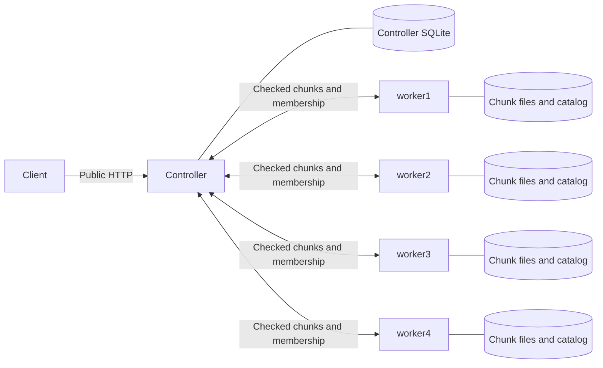

# Course object store architecture

The controller serves the public REST API and owns the authoritative object manifests. Four workers own the chunk files on separate persistent volumes. A CLI can run on the host or as a one-off container on the Compose network.

## Upload, read, and metadata

1. The controller stages the multipart upload and measures its length and SHA-256. It builds an ordinal manifest with 1,000,000-byte chunks and a possibly smaller final chunk.
2. The controller records each PUT intent before sending bytes to one of two distinct eligible workers. The worker validates the length and checksum, flushes a staged file, atomically renames it, and durably records the outcome before replying.
3. The controller publishes the object as ACTIVE only after every chunk has two matching receipts. Unfinished uploads are hidden; startup turns interrupted uploads into cleanup work.
4. Download follows ordinal order, tries eligible placements, and verifies each returned length and checksum. It assembles a quota-limited temporary file and verifies the complete object before starting the response. A missing valid copy produces 503.

Object metadata and chunk descriptors live in SQLite and can be read without fetching bytes from workers. PATCH merges custom keys in one transaction and advances the modification time and revision. List and metadata APIs expose ACTIVE objects only.

## Worker health and integrity

A volume retains its storage ID across restarts. Each worker process has a new boot ID. Heartbeat age is measured on the controller's local monotonic clock. A late or restarted worker rejoins through inventory reconciliation. The controller trusts its manifest's expected hash and confirms placements with checked reads. A heartbeat only establishes reachability.

Each worker checks one placement at a time in fixed UUID order. It persists the cursor with the scan outcome and retries sending a fault until the controller durably acknowledges its report ID. Repairs and reads still have their own checksum checks. Integrity scans can therefore detect damaged data even without a client reading the object.

## Repair and rejoin

Each periodic controller pass considers recorded placements, worker eligibility, and faults. A serial coordinator selects one chunk, checks a readable source against the original manifest, and writes to a distinct healthy worker with capacity. A defect can be repaired in its original slot using a newer operation. An outage can temporarily leave a third recorded copy while two are available elsewhere.

Repair puts use the same durable intent and receipt checks as upload. Intent, object state, controller epoch, and worker identity are checked before publishing. A read of a returning replica proves its bytes. If a journaled write survived a lost reply, a fresh durable PUT confirms the placement before it is published. To remove an excess copy, the controller freshly checks two retained copies and journals the retirement before issuing the bounded worker DELETE. Failures remain visible through the status route and get a bounded retry delay.

## Deletion and limits

Deletion commits a terminal intent and hides the object before waiting for the transfer lock. All four workers receive a durable generation tombstone, including those with no chunks for that object. Workers remove files and return a matching acknowledgement. Public DELETE returns 204 after all four acknowledgements, or 503 while cleanup is pending. An in-flight repair cannot publish after the controller hides an object. Reissued operations use persisted epochs and sequences to prevent older requests from reviving or removing newer state.

The single controller is an availability dependency. Two copies can survive the loss of one placement per chunk, and two bad or unavailable copies can make an object unavailable. The demo uses local Docker volumes, which share the host's failure domain. The repair scheduler is serial and the scan order is fixed. Status reports current controller knowledge, which can lag a fresh failure until a read, heartbeat timeout, or scan detects it.
